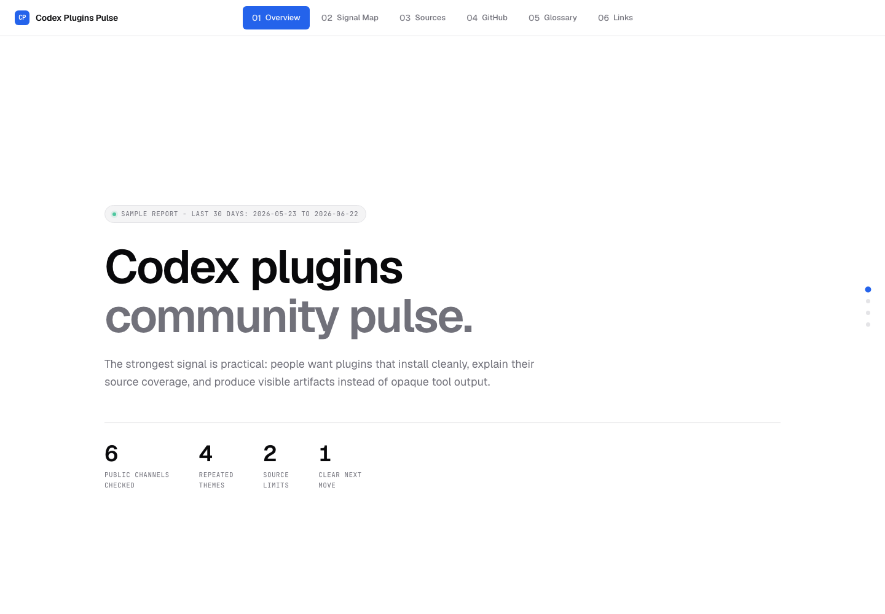
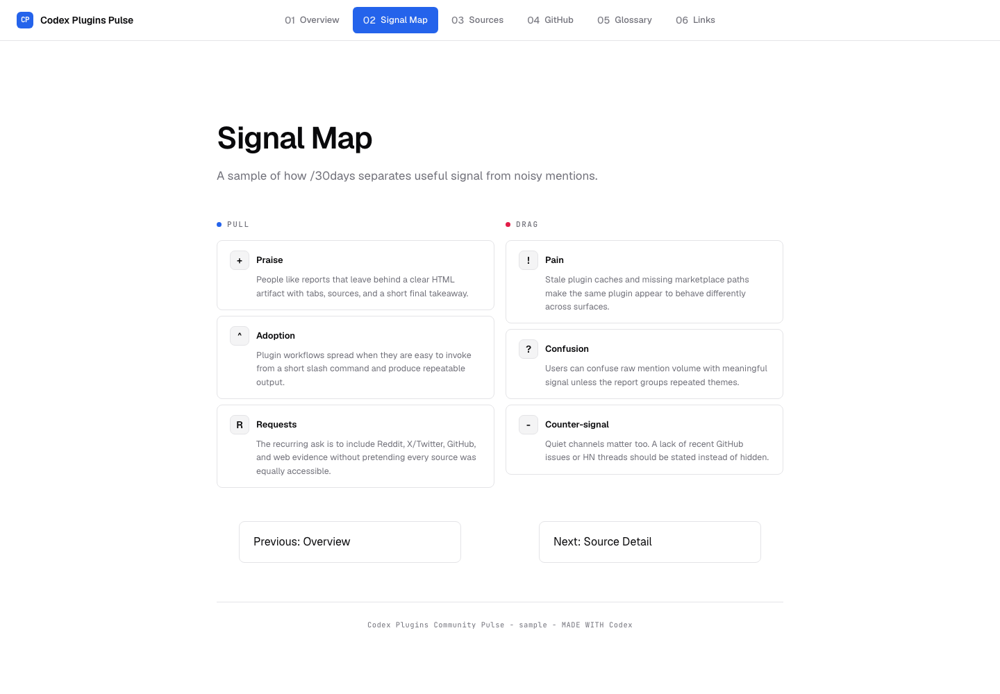

# infographic-docs

A Codex / Claude Code / Cowork plugin that produces **folder-based, multi-page HTML explainers** and **last-30-days community pulse reports** in a consistent style guide — the same look as the [Codex weekly updates doc](https://github.com/therealityreport).

When you ask for "create an HTML doc to explain X", "write a weekly update report", "build an infographic about Y", or any other explanatory-document request, the bundled skill activates and generates a directory of linked HTML files instead of one giant inline-styled page.

When you ask for "what is the community saying about X in the last 30 days" or run `/30days X`, the plugin researches public/community discussion across Reddit, X/Twitter, GitHub, Hacker News, YouTube, blogs/news, and other relevant sources, then turns the signal into a multi-page HTML doc.

## What you get

- **Multi-page output.** Top-level tabs are separate HTML files (`index.html`, `changelog.html`, `glossary.html`, `sources.html`, etc.), not anchors-in-one-file with JS toggles. Real URLs, real browser navigation.
- **Complete document folders.** Every library entry is one folder containing at least `index.html` and `meta.json`; loose HTML and sidecar metadata are retired.
- **One shared stylesheet.** All pages reference the same `assets/styles.css` — tinted per doc by overriding a single token (`--primary`).
- **Consistent design language.** The shadcn/ui system — Geist (headings + body) + JetBrains Mono (labels/eyebrow/code), HSL design tokens, scroll-snap sections, fade-up animations, rounded cards with subtle 1px borders, and automatic light/dark mode.
- **Themed per topic.** Neutral by default; or tint with a preset (Codex teal, Anthropic warm, Stripe indigo, AWS orange, GitHub blue, Linear iris, Supabase emerald, Tailwind sky). Or roll your own from one HSL triple.
- **Composable components.** Hero with stats, timeline with colored dots, two-column release grid, 3-up highlight grid, impact stats + pull quotes, changelog entries, glossary term list, sources grid, prev/next pagination.
- **Built-in glossary tab.** Every doc carries a Glossary tab that defines, in plain English, every term and acronym used in the other tabs — so the explainer stays readable for non-coders.
- **30 Days community pulse.** A dedicated skill creates public-signal reports with tabs for Overview, Signal Map, Source Detail, GitHub / Builder Signal, Glossary, and Sources.
- **Reusable 30 Days templates.** The community-pulse skill includes fill-in HTML templates for the standard report tabs.
- **External-tool routing.** The plugin knows when to route to shadcn, Playwright MCP, Mermaid, Vega-Lite, validation tools, or Tool Finder without making any of them the default design system.
- **Preview wiring.** Codex gets a local Playwright MCP config for localhost previews, screenshots, snapshots, and PDF capture.
- **Diagram and chart bridges.** Mermaid `.mmd` files and Vega-Lite `.vl.json` specs can be rendered into doc-local assets with a bundled helper script.
- **Update tracking.** A Tool Finder watch file tracks the external packages and repos this plugin depends on conceptually.

## Install

### Codex

Add this marketplace and install the plugin:

```bash
codex plugin marketplace add therealityreport/toolihan
codex plugin add infographic-docs@toolihan
```

The Codex manifest points to `.mcp.json`, which defines the `infographic-preview-playwright` MCP server for optional previews.

### Claude Code

Add this marketplace and install the plugin in Claude Code:

```text
/plugin marketplace add therealityreport/toolihan
/plugin install infographic-docs@toolihan
```

### Cowork

Cowork uses the same plugin format. Drop the plugin into your Cowork plugins directory or install via the Cowork plugin manager.

## Usage

### Implicit (skill activates automatically)

Just ask Claude for an explainer-style HTML doc. Examples that activate the skill:

> "Create an HTML doc that details all the updates made to Codex over the past week."

> "Write a deep-dive explainer about how transformers work."

> "Summarize the Q1 product launches as an HTML report."

> "Make me an infographic about our team's hiring process."

### Explicit (slash command)

```
/infographic Codex weekly updates for the week of May 11
```

The skill will decide the structure (tabs, sections, palette), copy the shared stylesheet into the output directory, and build each tab as a separate HTML file.

### 30 Days community pulse

```
/30days last30days-skill forks
/30days what are people saying about Codex plugins?
/30days whatever we are talking about
```

The `community-30-days` skill researches the last 30 calendar days and produces a source-aware HTML report. It groups repeated public themes, preserves disagreement, calls out unavailable sources, and avoids dumping raw search results.

Sample output:





### Optional helpers

These are opt-in. The standalone HTML doc flow remains the default.

```bash
# Render Mermaid diagrams and Vega-Lite charts from a generated doc folder.
node scripts/render-visuals.mjs <topic-slug>

# Check the tracked external helper packages without installing anything.
node scripts/check-tool-updates.mjs
```

For browser preview proof, serve the generated doc folder over localhost and use the `infographic-preview-playwright` MCP server. See `skills/infographic-doc/reference/preview-mcp.md`.

## What it doesn't do

The skill explicitly does **not** activate for:

- Building web apps or single-page applications
- Creating dashboards with live data
- Landing pages or marketing sites
- Single-component demos
- Anything where the deliverable is application code rather than a standalone explanatory document

For those, use normal frontend tooling instead (Tailwind, shadcn, framework of choice).

## Plugin layout

```
infographic-docs/
├── .codex-plugin/
│   └── plugin.json                     ← Codex plugin manifest
├── .claude-plugin/
│   └── plugin.json                     ← Claude Code plugin manifest
├── .mcp.json                           ← Codex Playwright MCP preview wiring
├── README.md                           ← you are here
├── tool-finder.update-watch.json       ← external package/repo watch list
├── commands/
│   ├── infographic.md                  ← /infographic slash command
│   └── 30days.md                       ← /30days community-pulse command
├── scripts/
│   ├── tag-doc.mjs                     ← auto-tags a doc (brand tags from Use Cases pages) + rebuilds the library index
│   ├── render-visuals.mjs              ← renders Mermaid + Vega-Lite assets
│   └── check-tool-updates.mjs          ← checks tracked external helper packages
└── skills/
    ├── infographic-doc/
    │   ├── SKILL.md                    ← when/how the skill activates
    │   ├── assets/
    │   │   └── styles.css              ← canonical stylesheet (copied into each output)
    │   ├── templates/
    │   │   └── nav-script.js           ← shared client script (copied into each output)
    │   │                                  (the HTML page skeleton lives inline in SKILL.md —
    │   │                                   keeping it out of a standalone .html file means it
    │   │                                   never renders as unstyled junk when previewed)
    │   └── reference/
    │       ├── palettes.md             ← preset palettes + how to roll your own
    │       ├── components.md           ← every CSS class with minimal HTML example
    │       ├── multi-page.md           ← tab bar wiring, prev/next, sub-pages
    │       ├── tagging.md              ← the 5 tag dimensions + how a doc gets tagged
    │       ├── external-tools.md       ← when/how to route external helpers
    │       ├── preview-mcp.md          ← localhost-first Playwright MCP preview flow
    │       └── diagrams-charts.md      ← Mermaid and Vega-Lite bridge conventions
    └── community-30-days/
        ├── SKILL.md                    ← last-30-days Reddit/X/GitHub/community pulse docs
        └── templates/                  ← reusable HTML tab templates for /30days reports
```

## Example output

Every doc lands in its own folder under `${KB_ROOT}/info-docs/`, named for the tool/skill/topic it covers:

```
${KB_ROOT}/
├── index.html                  ← library index (generated — a filterable card per doc)
├── tags.json                   ← controlled tag vocabulary (5 dimensions)
├── build-index.mjs             ← regenerates index.html from every doc's meta.json
└── info-docs/
    └── codex-weekly-may-11/
        ├── index.html              ← Overview tab (active)
        ├── changelog.html          ← Full Changelog tab
        ├── glossary.html           ← Glossary tab (plain-English term definitions)
        ├── sources.html            ← Sources tab
        ├── meta.json               ← tags + title/desc for this doc
        ├── visuals/                ← optional Mermaid or Vega-Lite source files
        └── assets/
            ├── generated/          ← optional rendered diagram/chart assets
            ├── styles.css
            └── nav-script.js
```

Open the doc's `index.html` in a browser. The tab bar at the top links to the other pages; each page has the same shell with its own tab marked `active`.

Each doc also carries a `meta.json` — tags across five dimensions (kind / subject / platform / topic / brand). Running `node build-index.mjs` from the knowledge-base root inlines all of them into root `index.html`, which renders a filterable card per doc (no build step to *view* it — it opens straight from `file://`). Helpers use `KB_ROOT` for that repository root and accept `KB_INFO_DOCS` only as an explicit document-directory override. See `skills/infographic-doc/reference/tagging.md`.

## Customizing the style guide

To change the default palette (currently Codex teal), edit the palette variables in the page skeleton inside `skills/infographic-doc/SKILL.md`, or use one of the presets in `skills/infographic-doc/reference/palettes.md`.

To change typography, edit the Google Fonts `<link>` and the `font-family` declarations in `skills/infographic-doc/assets/styles.css`.

To add a new component class, append to `styles.css` and document it in `reference/components.md`.

## Why multi-page?

Single-file HTML docs hit hard limits:

- Browsers struggle past ~1MB of HTML when scroll-snap, IntersectionObservers, and large DOMs combine.
- Search engines can't link to a tab.
- Browser back/forward doesn't work between "tabs."
- Sharing a specific section means screenshotting, not URL-copying.
- Tab-toggle JS is a vector for visual glitches and a tax on every page render.

Multi-page sidesteps all of that. Each tab is a real document. The CSS does the unifying.

## License

MIT — use, fork, theme, ship.
